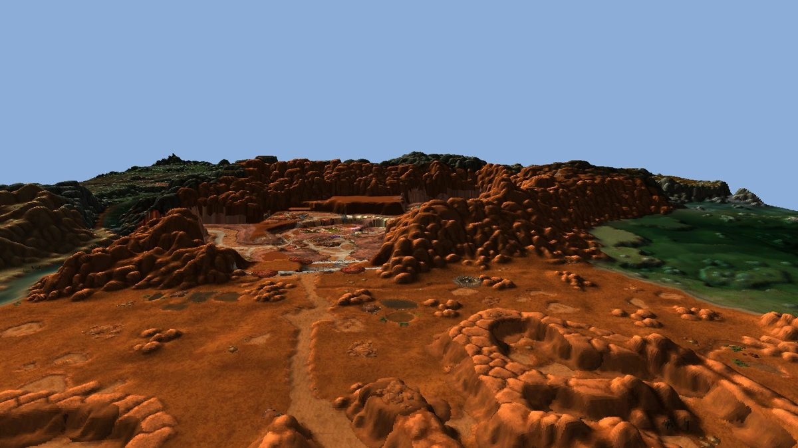

# 3D map for the cinematic mode (plan)

Status: planned on 2026-11-03, branch `investigate/3d-map-viewer`. Nothing is built yet.

The cinematic mode gets a second stage under the same replay: the real terrain of Kalimdor and the Eastern
Kingdoms in 3D, filmed by a drone camera that follows the player. Everything else in the cinematic stays as it
is: the HUD, toasts, banners, polaroids, sounds, music, credits and video export. The 2D map remains the
default and the fallback.



*Feasibility proof (CPU, 2.6 s for 5 × 5 tiles): real terrain heights from the local install, coloured with the
client's minimap tiles. Buildings and trees are only painted on.*

## Decisions (user, 2026-11-03)

| Topic | Decision |
|---|---|
| Placement | A 3D mode of the cinematic, not a new map view (see "No desktop map page"). Settings choose 2D or 3D. |
| Fidelity v1 | Terrain only: real heights and water, coloured by the client's minimap tiles. Ground textures, buildings (WMO) and trees/props (M2) are later phases. The data and renderer must leave room for them. |
| Camera | A high drone follow, about 150–300 yd behind and above the marker at about 45°. It turns slowly behind the direction of travel (8–10 s lag) and turns north-up again when it pulls high (flights, teleports, credits). |
| Data | Baked once by a tool and **committed to git**, like the map images. The minimap art is kept at the client's full 512 px per tile (~160 MB). |
| Renderer | `QOpenGLWidget` with hand-written GLSL, using PySide6's own OpenGL classes only (no new dependency). |
| Continents | One shared 3D world: both continents placed as on the world map, with ocean between them. Boats cross it, and teleports fly over it as today. Zephras Isle keeps the cloud transition. |
| Underground | Marker and route are drawn faintly through the terrain where they are hidden (an X-ray pass). Undercity and Ironforge get a known floor height. |
| Marker | Today's marker (class-colour arrow, gryphon/wind rider, ghost wisp, portal) as a camera-facing billboard with a soft ring of light on the ground. |
| Pins | Standing in the terrain: a small banner on a pole per moment, a polaroid on a stand per screenshot. |
| Daylight | A real sun angle from the recorded local time, with terrain shadows, a night sky with stars and moonlight, and haze in the sky colour. It uses the existing `cine_daylight` option. The haze is atmosphere, **not** fog of war (removed 2026-10-19, never re-add). |
| Rollout | Opt-in setting "3D-Karte" under Settings > Kino, off by default. It is hidden without OpenGL 3.3. It becomes the default once it is as good as 2D. |
| Milestone 1 | A spike in a standalone dev window before the cinematic is touched. |

Unchanged on purpose: no dungeon maps (inside instances the marker stays at the entrance), and the end credits
are untouched.

## What the game files give us

Checked against the installed client on 2026-11-03 with `wow/casc.py` (all readable, nothing encrypted):

- `Azeroth.wdt` (fileDataID 775971) and `Kalimdor.wdt` (782779). Their `MAID` chunk lists 8 fileDataIDs per tile:
  root ADT, obj0, obj1, tex0, lod, map texture, normal map texture, minimap. There are **736** Eastern Kingdoms tiles and
  **988** Kalimdor tiles, each 533⅓ yd square.
- Root ADT (~450 KB): 16 × 16 `MCNK` chunks, each with `MCVT` (145 heights: 9 × 9 outer, 8 × 8 inner), `MCCV`
  (vertex colours), `MCNR` (normals) and a base position. Liquids (`MH2O`) are in the root ADT where a tile has any.
- `_lod.adt` (~300 KB): low-detail heights for distant terrain.
- tex0 (~0.6–1.2 MB): ground texture layers and alpha maps (`MCLY`/`MCAL`) for the future "real ground textures" phase.
- obj0: building and doodad placements (`MODF`/`MDDF`) for the future WMO/M2 phases.
- Minimap: a BLP2 per tile, 512 × 512, with the artists' shading and the buildings/trees painted in.
- `UnitPosition` returns z = 0 (probe 2026-10-14). **The addon never records height.** Every height comes from the
  terrain, flights excepted (TaxiPathNode has real 3D nodes).

## Data pack (baked, in git)

`tools/build_terrain.py` (like `extract_maps.py`: reads the local CASC, writes into the repo, rerun after client
patches) writes `desktop/forever_chronicle/terrain/`:

| File | Content | Size (est.) |
|---|---|---|
| `index.json` | Format version, client build, per continent: tile list and offset in the shared world; per uiMapID: yard rectangle (UiMapAssignment); underground floor heights; taxi path nodes (x, y, z) | < 1 MB |
| `<continent>/h_<x>_<y>.bin` | 129 × 129 heights (outer vertices), int16 in 0.1 yd steps over a per-tile base, zlib; plus a 16 × 16 hole mask | ~20 KB/tile, ~35 MB |
| `<continent>/w_<x>_<y>.bin` | Liquid per chunk (height, type, 8 × 8 mask), only for tiles with water | small |
| `<continent>/m_<x>_<y>.jpg` | Minimap tile, 512 px, JPG q85 | ~70 KB/tile, ~120 MB |
| `<continent>/overview.jpg` + `overview_h.bin` | The whole continent at 32 px and 17 × 17 heights per tile, for the far view | ~3 MB |

One file per tile keeps rebuilds small: after a patch, only the tiles that changed get new git objects (the tool
compares hashes and leaves unchanged files untouched). Zephras Isle (MapID 2991) gets its own folder.

## Architecture

```
domain/terrain.py         pack loading, height sampling (bilinear), uiMap xy -> continent yards -> shared world
ui/stage.py               Stage protocol the cinematic talks to; Stage2D wraps today's CinemaView
ui/stage3d/
    view.py               Stage3D(QOpenGLWidget): frame loop, passes, offscreen render for export
    terrain.py            far mesh (whole continent, static VBO) + near ring of full tiles, streamed by a worker
    water.py              sea plane at z = 0 where no tile exists, MH2O surfaces elsewhere
    sky.py                sun/moon direction from domain/daylight.py, sky dome, stars, haze, terrain shadow map
    route.py              route ribbon on the terrain (+ small lift), drawn again faintly where depth-hidden (X-ray)
    sprites.py            marker, companions, pins and polaroids as textured quads; the textures are painted
                          with the existing QPainter code (draw_flyer, MarkerItem, pins) into QImages
    camera.py             drone rig: 2D camera state (centre, scale) -> target, distance, pitch, lagged yaw
```

**The seam.** The cinematic's camera logic (`_follow`, zoom targets, dives, voyages, fly-to teleports) works in
seamless world-map units and a view scale. It stays the single source of truth. The 3D stage takes the same
centre and scale and turns them into a drone pose: the scale becomes a distance chosen so the visible ground is
as wide as the 2D frame, and the pitch steepens with height. That means the 3D replay paces exactly like the 2D
one, and every camera behaviour carries over without a second implementation. The overlays that need screen
positions (polaroids flying out of the marker, quest marks over the marker) ask the stage `to_screen(point)`.

**Coordinates.** Route points are zone map coordinates. UiMapAssignment turns them into continent yards, and a
per-continent offset places each continent in the shared world, fitted so the layout matches `CONTINENT_IN_WORLD`
at one common scale. (Phase 0 checks that the scale really is common; otherwise use the nearest fit and accept
slightly wider or narrower oceans.)

**Heights.** Route, marker and pins sample the terrain. Flights use the TaxiPathNode heights of the matching path
(fallback: a smooth altitude above the highest terrain under the course). Undercity and Ironforge use their floor
height from `index.json`. Caves, mines, bridges and building floors are not known in v1: the marker stays on the
terrain there, and the X-ray pass shows it where the ground hides it.

**Per-frame cost.** No per-vertex Python. Meshes are numpy arrays uploaded once, and per frame Python sets
uniforms and issues draw calls for the visible tiles only. Tile loading (zlib + JPG decode) runs in a worker
thread, and the GL upload happens on the GUI thread, a few tiles per frame.

**Spirit world, day/night.** Grey is a shader uniform (desaturate + `SPIRIT_TINT`), replacing the
`QGraphicsColorizeEffect`. The time of day sets the sun direction, sky colours and haze.

**Export.** `cinematic_export` records the window with `QWidget.render()`. Phase 0 checks that this captures the
`QOpenGLWidget` correctly; otherwise the stage renders into a framebuffer object and the recorder reads it back.

## Phases

0. **Spike (milestone 1).** `build_terrain.py` for Kalimdor (it's quick anyway) and `tools/terrain_spike.py`: a
   dev window with terrain, water and sea, the drone camera gliding along one real session's route from the
   database, and the marker billboard. It should answer: fps on your PC and on a weak laptop, tile streaming
   hitches, memory, whether the coordinates line up (route in Durotar on the roads, Orgrimmar gate), shared-world
   scale, and `QWidget.render()` capture.
1. **Full bake.** Both continents and Zephras Isle, with water and taxi nodes; commit the pack (~160 MB) with
   tests for `domain/terrain.py` (sampling, coordinate chain, known points like Orgrimmar and Stormwind gate).
2. **Stage seam.** Move the cinematic behind `Stage`/`Stage2D` with no visible change, keeping all existing tests
   green. This is the main refactor of the 2,000-line `cinematic.py`.
3. **3D stage.** Route ribbon with X-ray, marker, companions, standing pins and polaroids, flights on taxi
   heights, voyages and teleports over the shared world, cloud trips to Zephras Isle, the spirit world, sun, sky
   and haze, and the credits pull-back.
4. **Opt-in.** Setting "3D-Karte" (Settings > Kino), OpenGL 3.3 check, fallback to 2D when the pack or GPU is
   missing, export verified, CHANGELOG/NEXT_STEPS updated. Friends get it with `git pull`.
5. **Polish → default.** Once it holds up against 2D in real sessions, 3D becomes the default.

Later phases, each with its own size and effort check before starting:

- **Real ground textures:** tex0 layers and alpha maps blended in the shader (the minimap stays for the far view).
  This adds ground texture BLPs plus alpha maps to the pack.
- **Buildings (WMO):** placements from obj0, WMO root/group parsing. This also gives real floors (bridges, cities)
  and fixes the marker height in towns.
- **Trees and props (M2):** doodad placements and M2 models with instancing. This is the heaviest phase on weak PCs.

## Risks and open points

- **Repo size.** ~160 MB at first, more with every client patch that touches terrain. Friends' first `git pull`
  after phase 1 is big. Accepted by the user; revisit if patches churn many tiles.
- **Python and OpenGL.** PySide6's `QOpenGLFunctions` are verbose but complete enough (VAO/VBO, shaders, FBOs,
  instancing). Phase 0 confirms that no extra GL binding is needed.
- **Weak GPUs.** OpenGL 3.3 core, a 5 × 5 near ring (~400k vertices) plus the far mesh (~500k) are fine for an
  iGPU, but shadows may need to be optional.
- **Wrong heights** where the player walks on buildings or bridges (until the WMO phase), and in caves.
- **Shared-world scale** may not be exactly common to both continents (see Coordinates).
